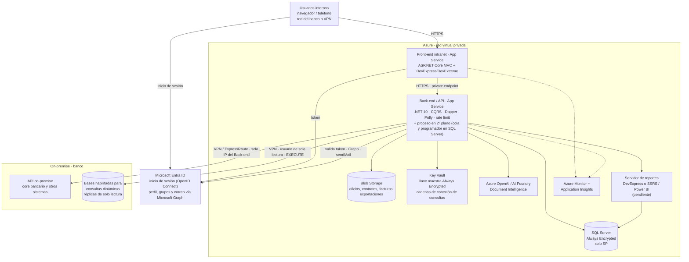
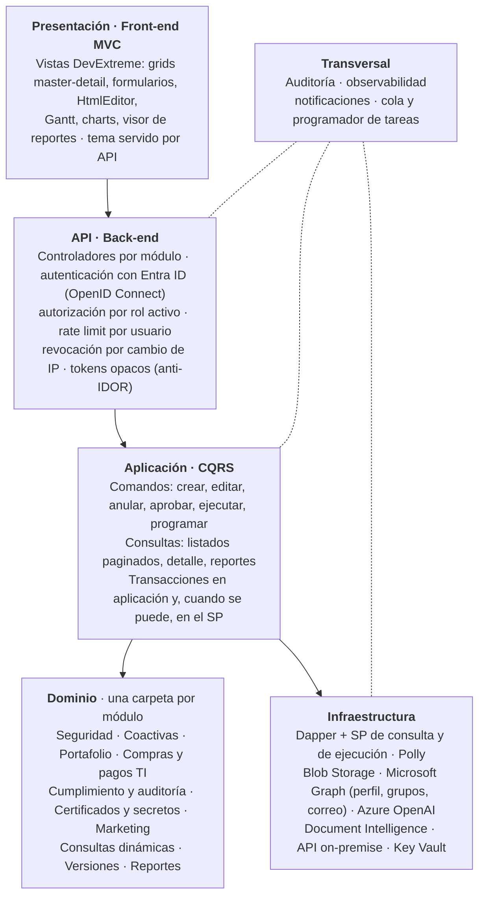
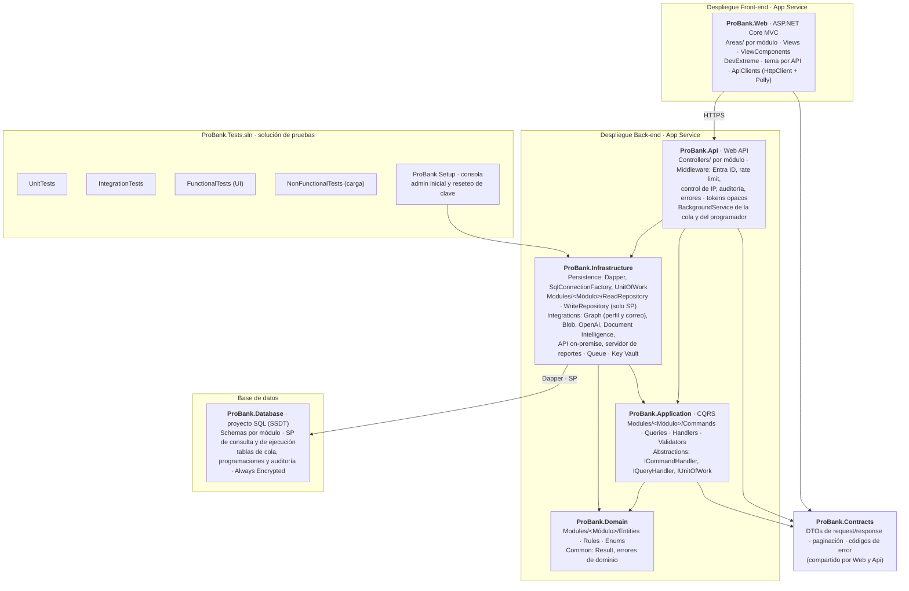

# Arquitectura de la Solución – ProBank

## Requisitos base
La arquitectura debe ser n capas, debe manejar la interfaz estándar en todas las páginas, UX/UI. La solución debe ser responsive y ajustarse a los diferentes dispositivos. Físicamente deben estar separados el Front-end Intranet, Back-end y la Base de datos en Azure. Las tecnologías a utilizar son .NET 10, Dapper, CQRS, DevExpress para el front-end, SQL Server, Blob Storage, Azure, Azure OpenAI, Foundry, Document Intelligence y segundo factor. La identidad de los usuarios se gestiona con Microsoft Entra ID (reemplaza al Active Directory on-premise).

Módulos de esta versión: Seguridad, Coactivas, Portafolio, Compras y pagos TI, Cumplimiento y auditoría, Certificados y secretos, Marketing, Consultas dinámicas, Versiones de aplicaciones y componentes, y Reportes.

---

## 1. Arquitectura física

Tres capas separadas en Azure (Front-end intranet, Back-end y Base de datos), Microsoft Entra ID para la identidad, los servicios de apoyo y la conexión con lo que está on-premise.



**Puntos clave**
- El inicio de sesión se hace en Microsoft Entra ID (OpenID Connect): ProBank nunca recibe la contraseña del usuario; el Back-end valida el token y obtiene perfil y grupos con Microsoft Graph.
- El Front-end no tiene acceso a la base; solo consume el Back-end.
- SQL Server, Blob Storage y Key Vault sin acceso público (private endpoints dentro de la red virtual).
- Contraseñas de cuentas técnicas y secretos cifrados con Always Encrypted; la llave maestra (CMK) está en Key Vault, el DBA no ve los valores en claro.
- Las cadenas de conexión de Consultas dinámicas se guardan como secretos en Key Vault; la base solo guarda su referencia y nunca se muestran en pantalla.
- El enlace VPN / ExpressRoute queda solo para la API on-premise y las bases habilitadas para consultas, que aceptan llamadas únicamente desde la IP del Back-end.
- Tareas largas (exportaciones de más de 5000 filas, cargas masivas de Excel, consultas programadas) van a una cola implementada en SQL Server (sin Service Bus): respuesta inmediata en estado pendiente y aviso en la campanita al terminar.
- Los correos de las consultas programadas salen con Microsoft Graph (sendMail) desde un buzón de servicio, con permiso Mail.Send limitado a ese buzón por política de acceso de aplicación.

---

## 2. Arquitectura lógica

Sistema modular en n capas. Cada módulo es una carpeta de dominio propia y se desarrolla sin afectar a los demás: Seguridad, Coactivas, Portafolio, Compras y pagos TI, Cumplimiento y auditoría, Certificados y secretos, Marketing, Consultas dinámicas, Versiones y Reportes.



| Capa | Responsabilidad |
|---|---|
| Presentación (Front-end MVC) | Vistas con DevExtreme: grids con detalle desplegable y solo buscador, formularios, editor enriquecido, Gantt, gráficos, visor de reportes. Responsive. Tema parametrizable por API. |
| API (Back-end) | Controladores por módulo. Autenticación con Microsoft Entra ID (OpenID Connect), autorización por rol activo, rate limit por usuario, revocación de sesión si aparece otra IP, tokens opacos en lugar de ID. |
| Aplicación (CQRS) | Comandos y consultas separados. Manejo de transacciones. |
| Dominio | Reglas de negocio de cada módulo. Ejemplos: una coactiva se ejecuta por orden judicial y admite bloqueo parcial; una tarea o una versión con varios aprobadores necesita la aprobación de todos; los pagos descuentan del presupuesto por partida; las credenciales solo las ven los miembros de su grupo de acceso. |
| Infraestructura | Dapper únicamente con procedimientos almacenados (SP de consulta y SP de ejecución en la misma base), Polly para reintentos, integración con Microsoft Graph (Entra ID y correo), servicios Azure y la API on-premise. |
| Transversal | Auditoría de todas las acciones (incluye consultas de credenciales, cambios de rol y cada ejecución de consultas dinámicas), no editable ni eliminable. Observabilidad con Application Insights. Notificaciones, cola y programador de tareas. |

### Seguridad lógica
- Inicio de sesión con Microsoft Entra ID (OpenID Connect, Microsoft.Identity.Web). La política de contraseñas y su vigencia las maneja Entra ID. Perfil (nombre, cargo, oficina, jefe) y grupos se leen en solo lectura con Microsoft Graph.
- Solo el administrador tiene cuenta local en la base, restringida a su IP. El administrador inicial y los reseteos se hacen con la herramienta de consola ProBank.Setup.
- Un usuario puede tener varios roles; trabaja con un rol activo y puede cambiarlo. Permisos por opción del menú × acción (ver, crear, editar, eliminar/anular, exportar, aprobar) y por función específica de cada pantalla (por ejemplo mostrar o copiar contraseña, enviar requerimiento de compra).
- El rol activo viaja en la sesión y se valida en el Back-end y en los SP; ocultar botones en pantalla es solo comodidad, no el control.
- Always Encrypted: CMK en Azure Key Vault, CEK en la base, cifrado RANDOMIZED, Microsoft.Data.SqlClient con Column Encryption Setting=Enabled, parámetros tipados en Dapper; el SP valida la pertenencia al grupo de acceso y registra la consulta en Auditoría.
- Consultas dinámicas: solo procedimientos almacenados (no se aceptan queries libres), parámetros tipados con DynamicParameters, usuario de base de solo lectura con EXECUTE en los esquemas autorizados, tiempo máximo y límite de filas por consulta, y quien solicita una ejecución no puede aprobarla.

### Reportería
Los reportes se diseñan y alojan en el servidor de reportes. ProBank solo registra en el catálogo la ruta, los parámetros y los roles; publicar uno nuevo no requiere desplegar una versión nueva. En ProBank los reportes son solo de visualización. Las consultas dinámicas complementan la reportería con resultados exportables (Excel, CSV, PDF, JSON y texto) y envíos programados por correo.

---

## 3. Tecnologías

| Área | Tecnología |
|---|---|
| Front-end | ASP.NET Core MVC (.NET 10) + DevExpress ASP.NET Core Controls / DevExtreme 25.2, tema Fluent compacto, Inter/Roboto, color de marca #D40E14 usado de forma sutil |
| Back-end | .NET 10 Web API, CQRS, Dapper, Polly, rate limiting nativo de ASP.NET Core |
| Datos | SQL Server con Always Encrypted, solo procedimientos almacenados, paginación en SP |
| Archivos | Azure Blob Storage |
| Inteligencia artificial | Azure OpenAI / AI Foundry, Document Intelligence |
| Identidad | Microsoft Entra ID (OpenID Connect, Microsoft.Identity.Web) + Microsoft Graph para perfil y grupos; segundo factor; ProBank.Setup para la cuenta local del administrador |
| Correo | Microsoft Graph sendMail desde un buzón de servicio (Mail.Send limitado a ese buzón) |
| Tareas programadas | BackgroundService de ProBank.Api sobre la cola en SQL Server |
| Secretos | Azure Key Vault |
| Reportería | DevExpress Report Server o SSRS / Power BI Report Server (pendiente) |
| Observabilidad | Azure Monitor + Application Insights (sin Grafana ni Sentinel) |
| Integración | API on-premise hacia el core y otros sistemas, por VPN o ExpressRoute |
| Calidad | Pruebas funcionales y no funcionales; pruebas de carga verificando que el pool de conexiones no se sature |

---

## 4. Solución .NET: distribución de proyectos

Dos desplegables independientes (Web y Api), un proyecto de base de datos y una solución de pruebas aparte. Cada módulo es una carpeta en cada capa: Seguridad, Coactivas, Portafolio, ComprasPagos, Cumplimiento, Credenciales, Marketing, ConsultasDinamicas, Versiones, Reportes.



**Reglas de dependencia**
- ProBank.Web solo conoce ProBank.Contracts y llama al Api por HTTPS; no referencia Application, Domain ni Infrastructure.
- ProBank.Domain no depende de nada.
- ProBank.Application define interfaces (repositorios, servicios externos) que implementa ProBank.Infrastructure.
- ProBank.Api es el único punto de composición (inyección de dependencias) del Back-end y aloja el BackgroundService de la cola y del programador de consultas.
- ProBank.Setup está en la solución de pruebas y reutiliza Infrastructure para crear el administrador inicial y resetear la clave.

**Estructura de carpetas**
```
ProBank.sln
├─ src/
│  ├─ ProBank.Web/                 ASP.NET Core MVC + DevExtreme
│  │  ├─ Areas/<Módulo>/Controllers, Views
│  │  ├─ Views/Shared/             layout, menú acordeón, cabecera, pie
│  │  ├─ ApiClients/               HttpClient tipados + Polly
│  │  └─ wwwroot/                  css, js, tema (variables servidas por API)
│  ├─ ProBank.Api/                 Web API .NET 10
│  │  ├─ Controllers/<Módulo>/
│  │  ├─ Middleware/               Entra ID, rate limit, IP, auditoría, errores
│  │  └─ BackgroundJobs/           cola y programador de consultas
│  ├─ ProBank.Application/         CQRS
│  │  ├─ Abstractions/
│  │  └─ Modules/<Módulo>/Commands, Queries, Handlers, Validators
│  ├─ ProBank.Domain/
│  │  ├─ Common/
│  │  └─ Modules/<Módulo>/Entities, Rules, Enums
│  ├─ ProBank.Infrastructure/
│  │  ├─ Persistence/              Dapper, SqlConnectionFactory, UnitOfWork
│  │  ├─ Modules/<Módulo>/         ReadRepository, WriteRepository (solo SP)
│  │  ├─ Integrations/             Graph (perfil y correo), Blob, OpenAI, DocIntelligence, OnPremApi, ReportServer
│  │  ├─ Queue/                    cola y programaciones sobre SQL Server
│  │  └─ Security/                 Key Vault, Always Encrypted
│  └─ ProBank.Contracts/           DTOs compartidos Web ↔ Api
└─ database/
   └─ ProBank.Database/            proyecto SQL: Schemas/<módulo>/Tables, StoredProcedures

ProBank.Tests.sln
├─ ProBank.UnitTests/
├─ ProBank.IntegrationTests/
├─ ProBank.FunctionalTests/        pruebas de UI
├─ ProBank.NonFunctionalTests/     carga y rendimiento
└─ ProBank.Setup/                  consola: admin inicial y reseteo de clave
```

---

## 5. Pendientes por definir
- Segundo factor: usar el MFA de Entra ID (con acceso condicional) o mantener el segundo factor propio de ProBank configurable por usuario.
- Servidor de reportes: DevExpress Report Server o SSRS / Power BI Report Server.
- Tipo de SQL Server en Azure: Azure SQL Managed Instance o SQL Server en VM (ambos soportan Always Encrypted).
- Enlace con on-premise: VPN o ExpressRoute.
- NServiceBus (por ahora solo Polly).
- Versiones: ambientes definitivos y aprobadores del paso a Producción.
- Consultas programadas: destinatarios permitidos (solo usuarios y grupos de Entra ID o también correos internos) y tamaño máximo del adjunto antes de enviar un enlace.
